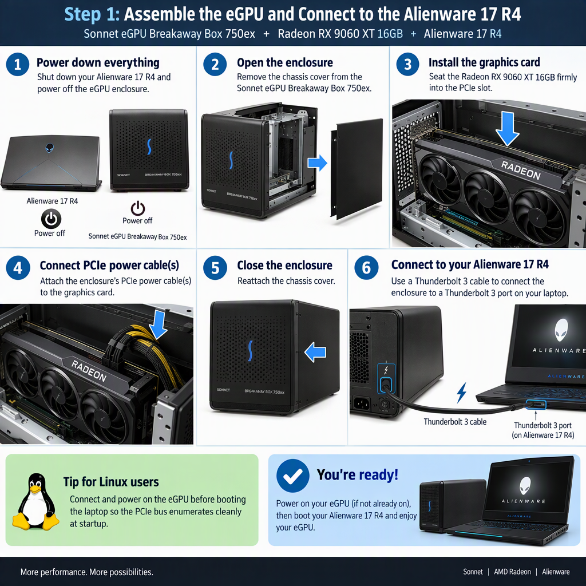

<div style="background-image: url('laptop-poc.png'); background-size: cover; background-repeat: no-repeat; background-position: center;">

# Bringing Alienware 17 R4 to Life

A practical "How To" guide for expanding the local AI capabilities of an **Alienware 17 R4** (32GB RAM, NVIDIA GeForce GTX 1070 8GB) using a **Thunderbolt 3 external GPU (eGPU) enclosure** and a **16GB AMD Radeon RX 9060 XT** graphics card—without upgrading or relying on NVIDIA hardware.

---

## Why an eGPU + 16GB AMD Card?

* **Soldered Internal GPU:** On the Alienware 17 R4, the internal graphics are soldered to the motherboard and cannot be swapped internally.
* **Thunderbolt 3 Expansion:** Using a Thunderbolt 3 eGPU enclosure lets you connect a desktop-class 16GB AMD Radeon RX 9060 XT over Thunderbolt 3 so local AI models (such as 12B–14B models in Ollama) have more VRAM headroom.
* **Offloading Without Disabling Your Display:** Your laptop can continue driving your main screen while Ollama is configured to target the external AMD GPU and bypass the internal GTX 1070.

---

</div>

## Components Needed & Pricing

The **Sonnet eGPU Breakaway Box 750ex** supports graphics cards up to **312mm x 160mm x 55mm** and provides a **750W power supply**. Below are the core components and prices found:

### 1. External GPU Enclosure
* **Sonnet eGPU Breakaway Box 750ex (GPU-750WEX-TB3)**
  * **Price:** **$399.99**
  * **Store URL:** [Sonnet Store — eGPU Breakaway Box 750ex](https://www.sonnetstore.com/products/egpu-breakaway-box-750ex)

### 2. 16GB AMD Radeon RX 9060 XT Graphics Cards
* **SAPPHIRE PULSE Radeon RX 9060 XT 16GB GDDR6**
  * **Price:** **$749.99** (Newegg listing; also listed at **$749.99** on Walmart)
  * **Store URLs:**
    * [Newegg — SAPPHIRE PULSE Radeon RX 9060 XT 16GB](https://www.newegg.com/sapphire-tech-pulse-11350-03-20g-radeon-rx-9060-xt-16gb-graphics-card-double-fans/p/N82E16814202457)
    * [Walmart — Sapphire RX 9060 XT Gaming 16GB](https://www.walmart.com/ip/Sapphire-RX-9060-XT-Gaming-16GB-GDDR6-Graphics-Card/16998815592)
* **GIGABYTE Gaming Radeon RX 9060 XT 16GB GDDR6**
  * **Price:** **$749.99** on Newegg / **$759.99** on Best Buy
  * **Store URLs:**
    * [Newegg — GIGABYTE Gaming Radeon RX 9060 XT 16GB](https://www.newegg.com/gigabyte-gv-r9060xtgaming-oc-16gd-radeon-rx-9060-xt-16gb-graphics-card-triple-fans/p/N82E16814932806)
    * [Best Buy — GIGABYTE Radeon RX 9060 XT GAMING OC 16G](https://www.bestbuy.com/product/gigabyte-radeon-rx-9060-xt-gaming-oc-16g-gddr6-pci-express-5-0-graphics-card-black/J3ZW9X7XQS/sku/6633162)
* **XFX Swift AMD Radeon RX 9060 XT 16GB GDDR6**
  * **Price:** **$749.99** on Newegg (check Best Buy for current promotional pricing, which has fluctuated around **$539.99–$749.99**)
  * **Store URLs:**
    * [Newegg — XFX Swift Radeon RX 9060 XT 16GB](https://www.newegg.com/xfx-swift-rx-96tsw16bq-radeon-rx-9060-xt-16gb-graphics-card-double-fans/p/N82E16814150914)
    * [Best Buy — XFX Swift AMD Radeon RX 9060 XT 16GB](https://www.bestbuy.com/site/searchpage.jsp?id=pcat17071&st=9060%20xt)

### Estimated Hardware Subtotal
* **$399.99** (Sonnet eGPU Breakaway Box 750ex) + **$749.99** (16GB RX 9060 XT) = **$1,149.98** (before taxes and any store-specific shipping/promotions).

---

## Step-by-Step Setup & GPU Offloading Guide

### Step 1: Assemble the eGPU and Connect to the Alienware 17 R4
1. Power down both the eGPU enclosure and your Alienware 17 R4.
2. Open the Sonnet eGPU Breakaway Box 750ex chassis and seat the **Radeon RX 9060 XT 16GB** firmly into the PCIe slot.
3. Attach the enclosure's PCIe power cable(s) to the graphics card and close the enclosure.
4. Connect the Thunderbolt 3 cable between the enclosure and the **Thunderbolt 3** port on your Alienware 17 R4.
   * *Tip:* If you run Linux, connect and power on the eGPU before booting the laptop so the PCIe bus enumerates cleanly at startup.



### Step 2: Authorize the Thunderbolt Device
* **Windows:** Open **Thunderbolt Control Center** (or respond to the connection prompt) and set the Sonnet enclosure to **Always Connect**.
* **Linux (Ubuntu/Debian):** Authorize the device in **Settings → Thunderbolt** or enroll it via `boltctl`.

### Step 3: Install Graphics Drivers for Compute
* **Windows:** Install the current **AMD Software: Adrenalin Edition** driver so the RX 9060 XT is recognized and exposed via Vulkan/compute APIs.
* **Linux:** Install AMD's `amdgpu` / ROCm packages (`amdgpu-install`) and add your user to the `render` and `video` groups:
  ```bash
  sudo usermod -aG render,video $USER
  ```
  Log out and back in for group permissions to take effect.

### Step 4: Configure Ollama to Offload to the AMD GPU
To direct Ollama away from the internal NVIDIA GTX 1070 and use the external AMD card:

1. **Hide the NVIDIA GPU from CUDA detection** by setting `CUDA_VISIBLE_DEVICES=-1`:
   * **Linux (`systemd` service):** Run `sudo systemctl edit ollama` and add:
     ```ini
     [Service]
     Environment="CUDA_VISIBLE_DEVICES=-1"
     ```
     Then reload and restart the service:
     ```bash
     sudo systemctl daemon-reload
     sudo systemctl restart ollama
     ```
   * **Windows (Environment Variables):** Open **Edit the system environment variables → Environment Variables**, create a variable named `CUDA_VISIBLE_DEVICES` with value `-1`, and restart the Ollama application/service.

2. **Verify GPU offloading:**
   * Start a model in Ollama and run:
     ```bash
     ollama ps
     ```
   * Check that the model loads onto the GPU rather than falling back to CPU-only execution.

---

## Quick Troubleshooting Checklist
* **Port check:** Confirm you are plugged into the dedicated **Thunderbolt 3** port on the Alienware 17 R4 rather than a standard USB-C data port.
* **Power check:** Make sure the external PCIe power connector(s) on the RX 9060 XT are fully clicked in and the Sonnet 750ex power switch is on.
* **Service restart:** Whenever you change environment variables or reconnect the eGPU while Ollama is running, restart Ollama so it re-queries available compute devices.

---

## Contributing

Contributions are welcome. Please open a pull request with a clear explanation of the change and its purpose.

---

## Help Me Help You

This project is independently built and maintained, and developing it takes time—especially testing integrations and keeping it reliable across Linux setups. Your support helps me continue improving the project, fixing issues, and keeping it free and local-first. If this project is useful to you, a contribution is greatly appreciated.


<a href="https://www.buymeacoffee.com/bryanspms" target="_blank">
  
</a>
&nbsp;&nbsp;
<a href="https://www.buymeacoffee.com/bryanspms" target="_blank">
  
</a>

---

## License

Alienware-17-R4-GPU-Upgrade is licensed under the [MIT License](LICENSE). Copyright (c) 2026
Bryan Price. See the license file for the full terms.

---

## Attribution

If you build upon this project, attribution is appreciated:

> Based on Alienware-17-R4-GPU-Upgrade (https://github.com/bryanspms/Alienware-17-R4-GPU-Upgrade) by Bryan Price